# ryoppippi's QMK Userspace

My keymaps, built against upstream [QMK](https://github.com/qmk/qmk_firmware) as an [External Userspace](https://docs.qmk.fm/newbs_external_userspace).

| Keyboard                                                    | Keymap                                                                                           |
| ----------------------------------------------------------- | ------------------------------------------------------------------------------------------------ |
| [Claw44 rev1](https://github.com/dailycraftkeyboard/claw44) | [`keyboards/dailycraft/claw44/keymaps/ryoppippi`](keyboards/dailycraft/claw44/keymaps/ryoppippi) |

## Layout



Generated from `keymap.c` with [keymap-drawer](https://github.com/caksoylar/keymap-drawer); also available as [PDF](keymap.pdf).

## Video

I talked about this Claw44 and split keyboards in general (in Japanese):

[](https://www.youtube.com/watch?v=Ls5FmNoLLws)

## Build

Everything is pinned through Nix (`flake.lock`), and CI runs the same commands as below. Each push to `main` publishes the firmware to the `latest` release.

Locally (`direnv allow` once, or `nix develop`, which also installs the git hooks):

```sh
just build   # nix build -> result/*.hex
just flash   # build, then flash; press the reset switch on each half
just draw    # regenerate keymap.svg and keymap.pdf
just fmt     # nix fmt (treefmt)
just check   # nix flake check: firmware, formatting, drawing up to date
just update  # nix flake update
```
