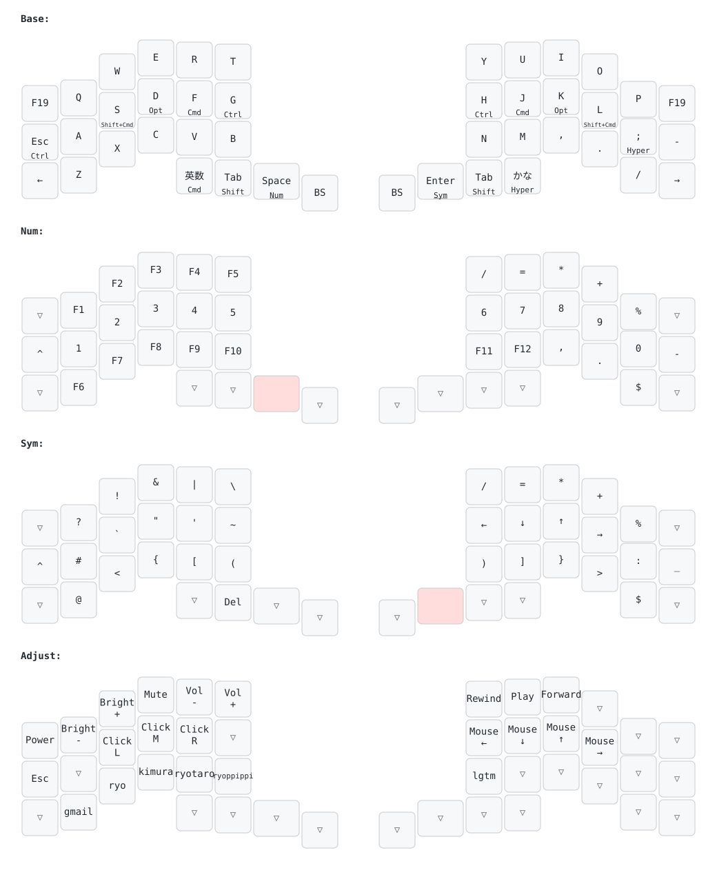
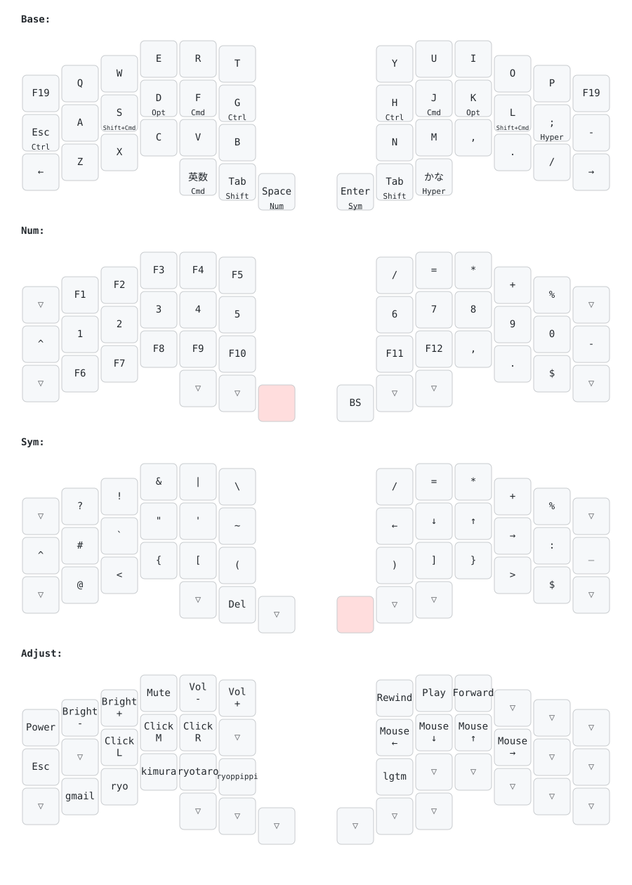

# ryoppippi's QMK Userspace

My keymaps, built against upstream [QMK](https://github.com/qmk/qmk_firmware) as an [External Userspace](https://docs.qmk.fm/newbs_external_userspace).

| Keyboard                                                    | Keymap                                                                                             |
| ----------------------------------------------------------- | -------------------------------------------------------------------------------------------------- |
| [Claw44 rev1](https://github.com/dailycraftkeyboard/claw44) | [`keyboards/dailycraft/claw44/keymaps/ryoppippi`](keyboards/dailycraft/claw44/keymaps/ryoppippi)   |
| [wings42 rev2](https://github.com/yfuku/wings42)            | [`keyboards/dailycraft/wings42/keymaps/ryoppippi`](keyboards/dailycraft/wings42/keymaps/ryoppippi) |

Code shared by both keymaps (layers, key aliases, macros and tapping behaviour) lives in [`users/ryoppippi`](users/ryoppippi).

## Layout

### Claw44



### wings42

英数 and かな sit on the two extra keys on the inner edge of the right half.



Generated from `keymap.c` with [keymap-drawer](https://github.com/caksoylar/keymap-drawer); also available as PDF ([Claw44](https://github.com/ryoppippi/qmk_userspace/releases/download/latest/keymap-claw44.pdf), [wings42](https://github.com/ryoppippi/qmk_userspace/releases/download/latest/keymap-wings42.pdf)).

## Video

I talked about this Claw44 and split keyboards in general (in Japanese):

[](https://www.youtube.com/watch?v=Ls5FmNoLLws)

## Build

Everything is pinned through Nix (`flake.lock`), and CI runs the same commands as below. QMK's own objects are cached as a separate derivation, so editing a `keymap.c` only recompiles and links that keymap (about 2 s), while editing `users/ryoppippi` rebuilds QMK's objects. `nix flake check` also runs QMK's full build and checks that it produces the same hex. Each push to `main` publishes the firmware and the keymap PDFs to the `latest` release.

Locally (`direnv allow` once, or `nix develop`, which also installs the git hooks):

```sh
just build       # nix build -> result/*.hex for every keyboard
just flash <kb>  # build, then flash claw44 or wings42; press the reset switch on each half
just draw        # regenerate drawings/*.svg (and untracked PDFs)
just fmt         # nix fmt (treefmt)
just check       # nix flake check: firmware, formatting, drawings up to date
just update      # nix flake update
```
